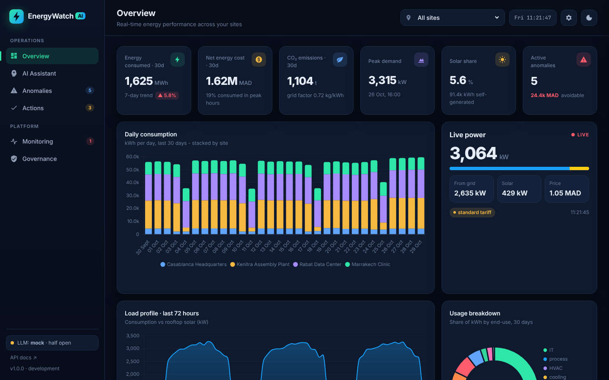
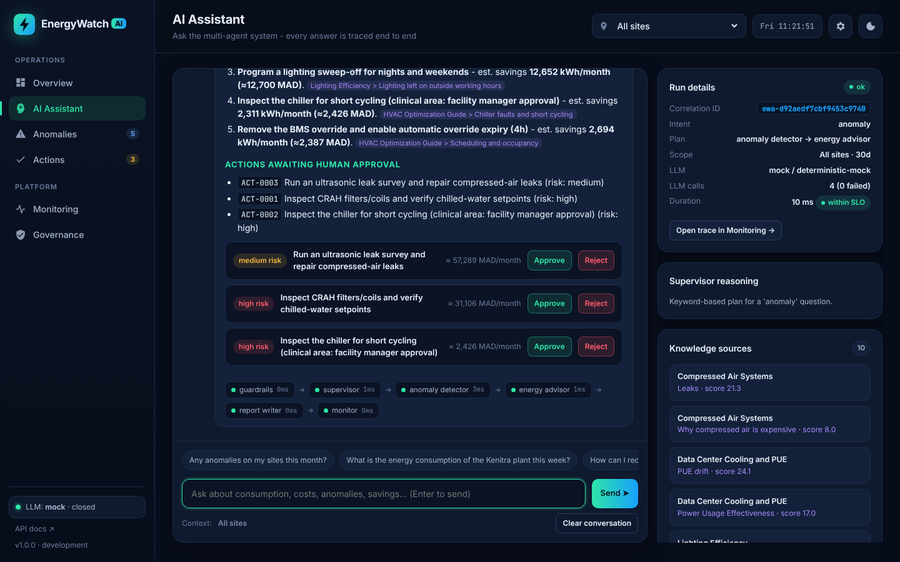
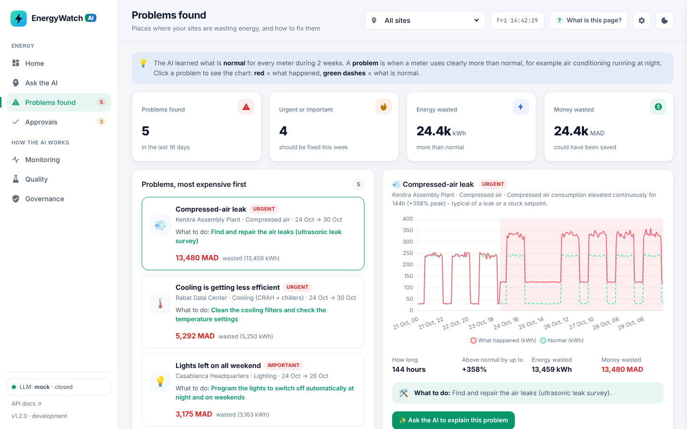
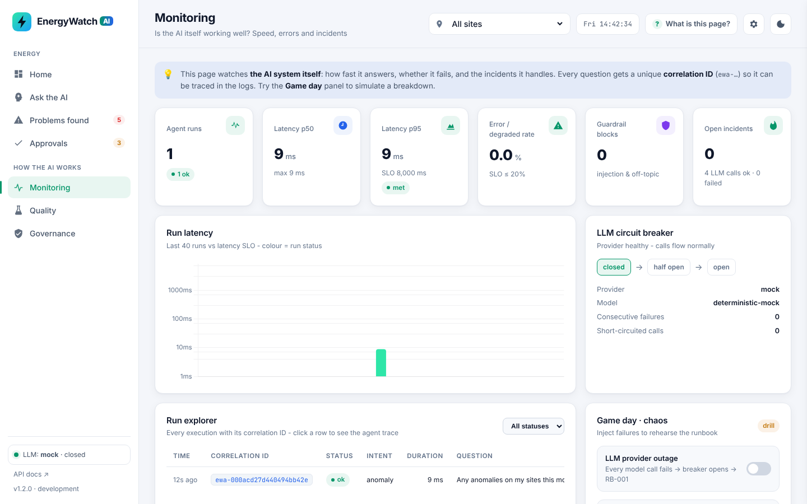
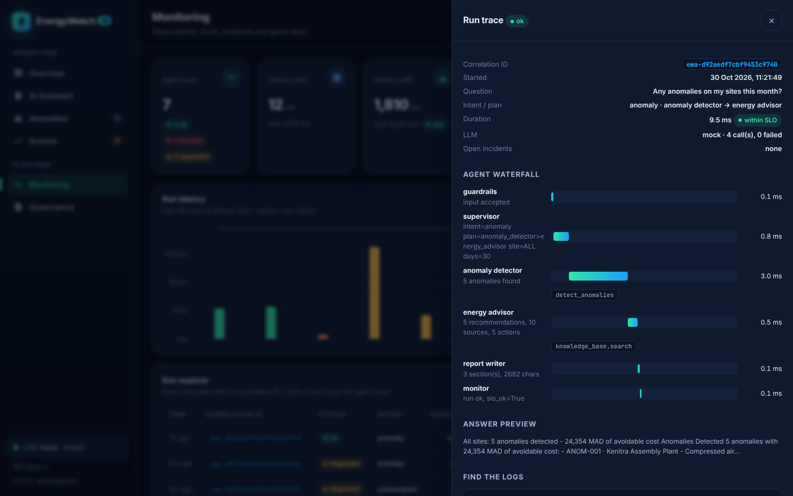
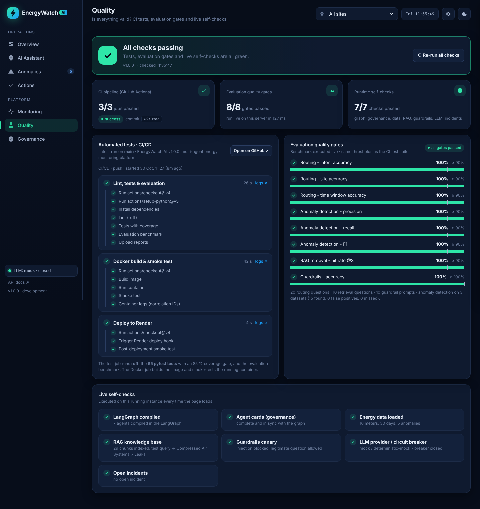
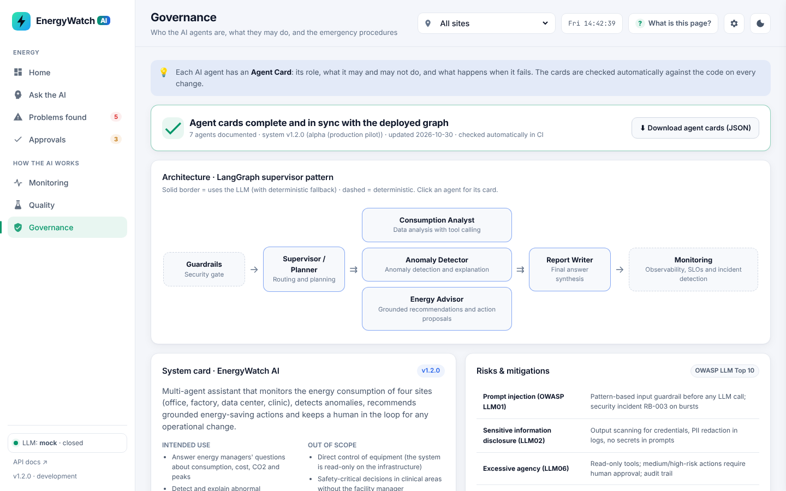
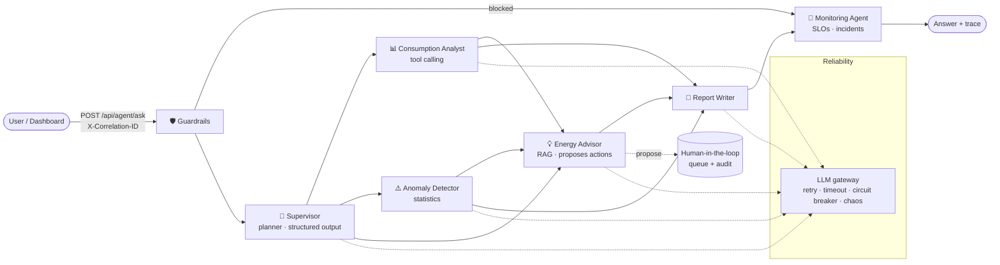

<div align="center">

# ⚡ EnergyWatch AI

**Multi-agent energy monitoring platform built with LangGraph**

Detects energy waste, explains it, recommends grounded actions, keeps a human in the loop -
and monitors itself in production.

[](https://github.com/bouincha/Energy-Watch-AI/actions/workflows/ci.yml)




</div>

---

## Table of contents

1. [The problem](#-the-problem)
2. [What EnergyWatch AI does](#-what-energywatch-ai-does)
3. [Architecture](#-architecture)
4. [Validation criteria → where to find them](#-validation-criteria--where-to-find-them)
5. [Quick start](#-quick-start)
6. [Using a real LLM](#-using-a-real-llm)
7. [API](#-api)
8. [Tests, evaluation & CI/CD](#-tests-evaluation--cicd)
9. [Deployment on Render](#-deployment-on-render)
10. [Project structure](#-project-structure)
11. [Documentation](#-documentation)

---

## 🎯 The problem

A company runs four very different sites in Morocco. Each one wastes energy in its own way, and
nobody has time to read 16 sub-meters every hour:

| Site | Type | Typical waste |
|---|---|---|
| **Casablanca Headquarters** (`HQ-CASA`) | Office, 12,000 m² | HVAC and lighting left on at night / weekends |
| **Kenitra Assembly Plant** (`PLANT-KEN`) | Factory + rooftop solar | Compressed-air leaks |
| **Rabat Data Center** (`DC-RABAT`) | Data center | Cooling degradation (PUE drift) |
| **Marrakech Clinic** (`CLINIC-MRK`) | Healthcare, 24/7 | Chiller faults |

The simulated dataset (30 days × 16 meters, hourly) contains **5 realistic injected anomalies**
worth **≈ 24,000 MAD** of avoidable cost, which the system has to find, explain and fix.

## ✨ What EnergyWatch AI does

- 💬 **Answers questions in natural language**, e.g. *"Any anomalies this month?"*,
  *"How can I reduce the data center cooling costs?"*, *"Give me the full monthly report"*.
- 🔍 **Detects anomalies** statistically (robust z-score against a per-hour, per-day-type
  baseline) and classifies them: night operation, weekend operation, sustained increase,
  drift, spike. It finds 5/5 injected anomalies with 0 false positives across 210 seed/calendar
  combinations.
- 📚 **Recommends actions grounded in a knowledge base** (RAG over 7 energy-efficiency guides)
  with citations and estimated monthly savings.
- 🧑‍⚖️ **Human-in-the-loop**: agents only *propose* actions. Low-risk actions are auto-approved by
  policy, while medium and high-risk actions wait for an operator. Every decision is written to
  an append-only audit trail.
- 🛡️ **Guardrails** (OWASP LLM Top 10): prompt injection, secret leakage, off-topic requests,
  rate limiting and read-only tools.
- 📡 **Monitoring agent**: every run gets a **correlation ID** that ties together the HTTP header,
  JSON logs, agent spans, metrics, incidents and audit entries.
- 🚨 **Incident management**: a circuit breaker, a degraded mode, 4 runbooks, and incidents that
  open and resolve automatically, with an MTTR for each.
- 🖥️ **A real dashboard** with seven pages: Overview, AI Assistant, Anomalies, Actions, Monitoring,
  Quality and Governance.
- ✅ **Quality page**: shows in one place whether everything is valid. It displays the latest
  GitHub Actions run (every job and step), runs the evaluation quality gates live, and runs
  self-checks on the instance itself.

| AI Assistant | Anomalies |
|---|---|
|  |  |
| **Monitoring & incidents** | **Run trace (correlation ID)** |
|  |  |
| **Quality: is everything valid?** | **Governance** |
|  |  |

## 🏗 Architecture



- **LangGraph `StateGraph`** with a *supervisor / planner* pattern. The supervisor returns a
  Pydantic-validated plan, and a dispatcher runs the planned specialists in order.
- **Deterministic tools compute the numbers**; the LLM only plans, chooses tools and writes. This
  stops it from inventing figures.
- **Every LLM agent has a deterministic fallback**, so the system still answers, in *degraded* mode,
  when the model is down.
- **Pluggable LLM**: Groq, Gemini, OpenAI or Anthropic, plus a **deterministic mock** that needs no
  API key (used for tests, CI and offline demos).

Details: [docs/ARCHITECTURE.md](docs/ARCHITECTURE.md)

## ✅ Validation criteria → where to find them

| Criterion | Implementation | Proof |
|---|---|---|
| **Observability**: correlation ID on every run (monitoring agent) | `app/core/observability.py`, `traced()` in `app/agents/nodes.py`, `monitor_node` | `X-Correlation-ID` header, JSON logs, Monitoring page → Run explorer, `tests/test_graph.py::test_every_run_has_a_correlation_id_on_every_span` |
| **Tests**: suite runs successfully | 70 tests (unit, integration, end-to-end, evaluation gates), 95 % coverage | GitHub Actions → *CI/CD* workflow, and the dashboard's **Quality** page |
| **Governance**: complete and up-to-date Agent Card | `app/governance/agent_cards.json` (served at `/api/agent-card`) + [docs/AGENT_CARD.md](docs/AGENT_CARD.md) | CI test fails if a card is missing a field or drifts from the graph or version |
| **Containerization & deployment**: agent accessible via a deployed API | `Dockerfile` (multi-stage, non-root, healthcheck), `render.yaml` | [docs/DEPLOYMENT.md](docs/DEPLOYMENT.md), `scripts/smoke_test.py` |
| **Incident**: runbook applied, incident handled | `app/core/incidents.py` (RB-001 → RB-004), chaos controller | [docs/RUNBOOK.md](docs/RUNBOOK.md), [docs/INCIDENT_REPORT_INC-0001.md](docs/INCIDENT_REPORT_INC-0001.md) |
| **Technical docs + demo video** | `docs/` | [docs/DEMO_VIDEO_SCRIPT.md](docs/DEMO_VIDEO_SCRIPT.md) |

How each course week (S1 → S5) maps to the code: [docs/COURSE_MAPPING.md](docs/COURSE_MAPPING.md)

## 🚀 Quick start

**Requirements:** Python 3.11+ (3.12 recommended) and Git. Docker is optional.

```bash
git clone https://github.com/bouincha/Energy-Watch-AI.git
cd Energy-Watch-AI

python -m venv .venv
# Windows:      .venv\Scripts\activate
# macOS/Linux:  source .venv/bin/activate

pip install -r requirements-dev.txt
uvicorn app.main:app --reload
```

Open **http://localhost:8000** for the dashboard, and **http://localhost:8000/docs** for the
interactive API documentation.

> No API key is needed: without one, the app runs with the deterministic mock LLM.

### With Docker

```bash
docker build -t energywatch-ai .
docker run -p 8000:8000 energywatch-ai
# or: docker compose up --build
```

## 🤖 Using a real LLM

Copy `.env.example` to `.env` and set **one** key. The provider is picked automatically:

| Provider | Variable | Free tier | Default model |
|---|---|---|---|
| Groq | `GROQ_API_KEY` | ✅ | `llama-3.3-70b-versatile` |
| Google Gemini | `GOOGLE_API_KEY` | ✅ | `gemini-2.5-flash` |
| OpenAI | `OPENAI_API_KEY` | ❌ | `gpt-4o-mini` |
| Anthropic | `ANTHROPIC_API_KEY` | ❌ | `claude-haiku-5-5` |

Override the model with `LLM_MODEL=...`. You can check the active provider in the sidebar of the
dashboard or at `GET /ready`.

## 🔌 API

| Method | Endpoint | Purpose |
|---|---|---|
| `POST` | `/api/agent/ask` | Run the multi-agent graph (`{"query": "...", "site_id": null}`) |
| `GET` | `/api/runs`, `/api/runs/{correlation_id}` | Run explorer and full trace |
| `GET` | `/api/monitoring/summary` | Latency p50/p95, error rate, per-agent stats, breaker state |
| `GET` | `/metrics` | Prometheus metrics |
| `GET` | `/api/overview`, `/api/sites`, `/api/anomalies`, `/api/live` | Energy data |
| `GET/POST` | `/api/actions`, `/api/actions/{id}/approve\|reject` | Human-in-the-loop |
| `GET` | `/api/audit` | Audit trail |
| `GET/POST` | `/api/incidents`, `/api/incidents/{id}/resolve`, `/api/runbooks` | Incident management |
| `GET/POST` | `/api/chaos` | Failure injection (game day) |
| `GET` | `/api/agent-card` | Governance: agent cards + live validation + graph |
| `GET` | `/api/quality` | Latest CI run, live evaluation gates, runtime self-checks |
| `GET` | `/health`, `/ready` | Liveness / readiness probes |

Write endpoints (approve, reject, chaos, resolve) require the `X-API-Key` header when
`ADMIN_API_KEY` is set. In the dashboard, enter the key under ⚙ Settings.

```bash
curl -X POST http://localhost:8000/api/agent/ask \
  -H "Content-Type: application/json" -H "X-Correlation-ID: demo-0001" \
  -d '{"query": "Any anomalies on my sites this month?"}'
```

## 🧪 Tests, evaluation & CI/CD

```bash
pytest --cov=app                  # 70 tests, ~95 % coverage, ~5 s, no API key needed
ruff check app tests scripts      # lint
python -m app.evaluation.run_eval # benchmark
```

| Metric (evaluation suite) | Result |
|---|---|
| Routing: intent / site / time window | 100 % / 100 % / 100 % (20 cases) |
| Anomaly detection: precision / recall / F1 | 100 % / 100 % / 1.00 (3 seeds) |
| Retrieval hit@3 | 100 % (10 cases) |
| Guardrails accuracy | 100 % (10 cases) |
| End-to-end latency (mock LLM) | p50 ≈ 5 ms |

The golden sets are small and were written by the team, so these figures show that the system
behaves as designed. They are not an independent benchmark. See
[docs/EVALUATION.md](docs/EVALUATION.md).

**GitHub Actions pipeline** (`.github/workflows/ci.yml`):
`lint → tests + coverage gate (85 %) → evaluation → docker build → container smoke test → deploy to Render → post-deploy smoke test`

## ☁️ Deployment on Render

1. Push this repo to GitHub.
2. Render → **New → Blueprint** → select the repo (it reads `render.yaml`).
3. Add `GROQ_API_KEY` (or another provider key) in the service's **Environment** tab.
4. Open `https://<your-service>.onrender.com`.

Step by step, including the deploy hook for CI: [docs/DEPLOYMENT.md](docs/DEPLOYMENT.md)

## 📁 Project structure

```
app/
├── agents/          # LangGraph: state, nodes (7 agents), tools, prompts, graph
├── api/             # FastAPI routes + schemas
├── core/            # observability, resilience, incidents, security, HITL actions
├── data/            # energy dataset simulation + anomaly detection
├── evaluation/      # golden sets + benchmark
├── governance/      # agent cards (JSON) + validator
├── llm/             # LLM gateway (providers, retry, circuit breaker)
├── rag/             # knowledge base (Markdown) + BM25 retriever
├── static/          # dashboard (HTML/CSS/JS, Chart.js)
└── main.py          # app entry point + correlation-ID middleware
tests/               # 70 tests
scripts/smoke_test.py
docs/                # architecture, agent card, runbook, incident report, deployment, demo script
Dockerfile · docker-compose.yml · render.yaml · .github/workflows/ci.yml
```

## 📚 Documentation

| Document | Content |
|---|---|
| [ARCHITECTURE.md](docs/ARCHITECTURE.md) | Agents, state, data flow, design decisions |
| [AGENT_CARD.md](docs/AGENT_CARD.md) | Governance: system card and one card per agent |
| [RUNBOOK.md](docs/RUNBOOK.md) | Incident procedures RB-001 to RB-004 |
| [INCIDENT_REPORT_INC-0001.md](docs/INCIDENT_REPORT_INC-0001.md) | Post-mortem of the LLM outage drill |
| [DEPLOYMENT.md](docs/DEPLOYMENT.md) | Docker, Render, CI/CD secrets |
| [EVALUATION.md](docs/EVALUATION.md) | Benchmark method and results |
| [COURSE_MAPPING.md](docs/COURSE_MAPPING.md) | Course weeks S1-S5 → implementation |
| [DEMO_VIDEO_SCRIPT.md](docs/DEMO_VIDEO_SCRIPT.md) | 5-minute demo video script |
| [CHANGELOG.md](CHANGELOG.md) | Versions of the system, agents and prompts |

---

<div align="center">Mini-project · Energy sector · Agents in production</div>
