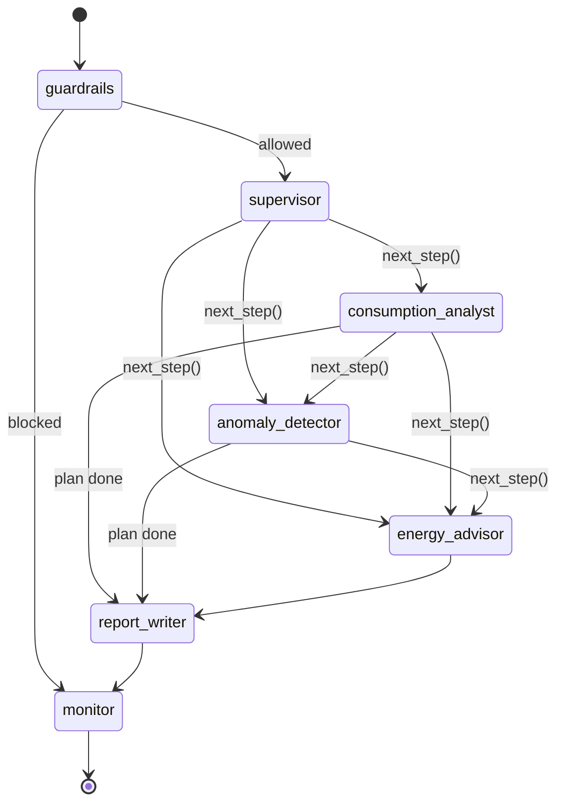

# Architecture

## 1. Overview

EnergyWatch AI is a **multi-agent system** built with **LangGraph**, exposed through a
**FastAPI** service that also serves the dashboard. One request means one *run* of the graph,
and every run is identified by a **correlation ID**.

```
Browser (dashboard)  ──HTTP──▶  FastAPI  ──▶  LangGraph StateGraph  ──▶  tools / RAG / LLM gateway
        ▲                          │                    │
        └──── JSON + X-Correlation-ID ◀──── run store, metrics, incidents, audit (in memory)
                                                       └──▶ JSON logs on stdout (durable)
```

## 2. The graph



**Pattern: supervisor / planner with a dispatcher.** The supervisor produces a plan (an ordered
list of specialists). After each node, the conditional edge `next_step()` picks the first planned
agent that hasn't run yet, or moves on to `report_writer`. The graph is code-defined (`app/agents/graph.py`),
and the LLM can only choose among the allowed agents, because its output is validated and
sanitized.

### Agents

| Agent | LLM? | Responsibility | Fallback |
|---|---|---|---|
| `guardrails` | no | Injection / off-topic / length checks before any LLM call | n/a |
| `supervisor` | yes (structured output) | Intent, site, window, plan | Keyword planner |
| `consumption_analyst` | yes (tool calling) | Chooses and calls data tools, summarizes | Rule-based tool choice + template |
| `anomaly_detector` | yes (explanation) | Runs statistical detection, explains root causes | Root-cause table template |
| `energy_advisor` | yes (RAG) | Retrieves knowledge, recommends, proposes actions | Playbook + citations |
| `report_writer` | yes | Final Markdown answer, output guardrail | Section template |
| `monitor` | no | SLO check, run record, metrics, incidents | n/a |

### Shared state (`app/agents/state.py`)

`EnergyState` is a `TypedDict`. Most keys are overwritten by the agent that owns them. Four keys
use **reducers**, so every agent can append to them:

- `completed: Annotated[list, operator.add]` lists the agents that have already run (used by the dispatcher)
- `trace: Annotated[list, operator.add]` holds one span per agent
- `errors: Annotated[list, operator.add]` collects contained failures
- `degraded: Annotated[bool, operator.or_]` becomes true if any agent fell back

## 3. Design decisions

| Decision | Why |
|---|---|
| **Numbers come from deterministic tools, never from the LLM** | Avoids hallucinated kWh/MAD figures (OWASP LLM09). The LLM plans, picks tools and writes. |
| **Every LLM agent has a deterministic fallback** | The service stays useful during a provider outage (runbook RB-001). |
| **One LLM gateway** (`app/llm/gateway.py`) | Timeouts, retries, circuit breaker, chaos injection, metrics and run accounting live in one place. |
| **Mock provider** | Tests and CI are free, fast and deterministic, and the demo works offline. |
| **BM25 retriever in pure Python** | No vector DB to operate; 29 chunks only. The `search()` interface can be swapped for a vector store. |
| **Statistical anomaly detection** (robust z-score) | Explainable, and fast (≈20 ms for 16 meters × 720 h). It is evaluated against ground truth. |
| **Human approval for medium/high-risk actions** | Excessive agency (OWASP LLM06); clinical and data-center operations are safety-critical. |
| **In-memory telemetry + JSON logs** | Simple for a single instance; logs are the durable source of truth on Render. To scale out, export to Prometheus / OpenTelemetry. |

## 4. Observability: how the correlation ID flows

1. `correlation_middleware` (`app/main.py`) reads `X-Correlation-ID`, or creates `ewa-<20 hex>`.
   Unsafe values are replaced.
2. The ID is stored in a `ContextVar` and returned in the response header.
3. `run_agent()` puts it into the graph state and the run store.
4. `traced()` re-binds it inside every node and records a `Span` (agent, duration, status,
   tool calls, error).
5. The `JsonFormatter` adds it to **every log line**. Incidents, audit entries and proposed actions
   store it too.

So `docker logs energywatch | grep <correlation-id>` returns the whole story of one request.

## 5. Reliability

```
agent ──▶ gateway._call()
            ├─ breaker open?  ──▶ LLMUnavailable (short-circuit, no waiting)
            ├─ chaos hooks (outage / latency)
            ├─ retry_call(attempts = LLM_MAX_RETRIES + 1, exponential backoff)
            ├─ failure ──▶ breaker.record_failure() ──(threshold)──▶ OPEN ──▶ incident RB-001
            └─ success ──▶ breaker.record_success() ──(was half-open)──▶ CLOSED ──▶ RB-001 resolved
agent catches LLMUnavailable ──▶ deterministic fallback, span status = degraded
```

## 6. Data

`app/data/energy_data.py` simulates 4 sites, 16 meters and 30 days of hourly data, with realistic
profiles (occupancy, shifts, outdoor temperature, solar curve) and 5 injected anomalies. In
production, replace `EnergyDataset` with a connector to the metering platform; the tools and
agents won't change.

Anomaly detection, per meter:
1. Baseline = median for each `(working day?, hour)` bucket over the first 14 days.
2. Robust scale = MAD of the training residuals (with a floor).
3. Hours with z > 3.5 and a +12 % deviation are flagged, then grouped (gaps ≤ 16 h bridged).
4. Noise filter: ≥ 3 hours or z ≥ 12, and cost ≥ 100 MAD.
5. Pattern classification: weekend, drift / sustained, night, spike.
6. Each event gets excess kWh, cost at the time-of-use tariff, and a severity.
